# Backlog — LedgerForce task list

The product owner's view of the build. Cards are `T-NNNN.md` in this folder (format: design §10.3 plus
`research`, `success_scenarios`, `evidence`, `estimate_lines`). Agents claim the **first `todo` card in the
table below whose `depends_on` are all `done`** (AGENTS.md §2). Rows are in dependency order.

- Status model: `todo → claimed → researching → in_progress → verifying → review → done`, plus `blocked`.
- Success scenarios (SS ids) live in [Docs/specs/success-scenarios.md](../../Docs/specs/success-scenarios.md).
- Keep this file accurate: the `new-task-card` and `checkpoint` skills update the row when a card changes
  (backlog-sync loop, Docs/process/loops.md). Generated initially on 2026-10-24 by the Sprint-0 scribe.

## Counts

| Status | Cards |
|---|---:|
| todo | 93 |
| in_progress | 1 |
| review | 7 |
| blocked | 1 |
| **total** | **102** |

| Phase | Cards |
|---|---:|
| Sprint 0 | 9 |
| MVP | 90 |
| Phase 1 | 1 |
| Phase 2 | 1 |
| Phase 3 | 1 |

Success scenarios: 121 (94 use-case, 27 platform).

## Critical path to the MVP gate

Longest dependency chain by estimated changed lines (~7400 lines, 24 cards). Any slip here slips the MVP gate.
Note that **T-0007 (golden postings) is blocked on human approval** and gates the golden-posting runner.

```mermaid
graph LR
  T0001["T-0001 Repo scaffold & tooling"]
  T0008["T-0008 DB test harness, platform baseline migration and RLS suite skeleton"]
  T0001 --> T0008
  T0010["T-0010 Tenancy"]
  T0008 --> T0010
  T0018["T-0018 Chart of accounts, system roles and AU templates"]
  T0010 --> T0018
  T0019["T-0019 Dimensions and deduplicated dimension sets"]
  T0018 --> T0019
  T0020["T-0020 Journal tables and deferred balance constraint trigger"]
  T0019 --> T0020
  T0021["T-0021 Immutability triggers and privilege model for ledger tables"]
  T0020 --> T0021
  T0022["T-0022 Hash chain per company and verification report"]
  T0021 --> T0022
  T0025["T-0025 Posting engine pipeline"]
  T0022 --> T0025
  T0031["T-0031 Golden-posting test runner"]
  T0025 --> T0031
  T0034["T-0034 Tax codes"]
  T0031 --> T0034
  T0038["T-0038 Products, party posting profiles and product posting profiles"]
  T0034 --> T0038
  T0039["T-0039 Posting-profile matrix resolution and gap check"]
  T0038 --> T0039
  T0050["T-0050 Supplier bills entry and suggested coding"]
  T0039 --> T0050
  T0052["T-0052 Bill approval workflow with SoD"]
  T0050 --> T0052
  T0054["T-0054 Payment batches with maker-checker and step-up release"]
  T0052 --> T0054
  T0056["T-0056 ABA"]
  T0054 --> T0056
  T0057["T-0057 Payment confirmation posting and remittance advices"]
  T0056 --> T0057
  T0060["T-0060 Matching rules and auto-match"]
  T0057 --> T0060
  T0061["T-0061 Bank reconciliation and reconciliation report"]
  T0060 --> T0061
  T0078["T-0078 Month-end close checklist"]
  T0061 --> T0078
  T0079["T-0079 Hard-lock reopen with two approvers and audit reason"]
  T0078 --> T0079
  T0090["T-0090 UI"]
  T0079 --> T0090
  T0099["T-0099 MVP gate"]
  T0090 --> T0099
```

## Index (dependency order)

| Id | Title | Phase | Status | Depends on | UCs | SS |
|---|---|---|---|---|---|---:|
| [T-0001](T-0001.md) | Repo scaffold & tooling (pnpm workspace, TS, lint, Vitest, CI skeleton) | Sprint 0 | review | — | — | 0 |
| [T-0002](T-0002.md) | AGENTS.md / CLAUDE.md, skills and sub-agent role files | Sprint 0 | review | — | — | 0 |
| [T-0003](T-0003.md) | Conductor, lease/heartbeat and provider failover loop | Sprint 0 | review | T-0001 | — | 2 |
| [T-0004](T-0004.md) | Seed ADRs 0001–0010 and decision log | Sprint 0 | review | — | — | 0 |
| [T-0005](T-0005.md) | Sprint-0 research pack (stack, Salesforce, ABA, RLS, Playwright, UI) | Sprint 0 | review | — | — | 0 |
| [T-0006](T-0006.md) | Backlog, use-case specs and success-scenario register | Sprint 0 | review | — | — | 0 |
| [T-0007](T-0007.md) | Golden postings DRAFT (human gate: golden_postings) | Sprint 0 | blocked | — | — | 0 |
| [T-0008](T-0008.md) | DB test harness, platform baseline migration and RLS suite skeleton | Sprint 0 | review | T-0001 | — | 2 |
| [T-0009](T-0009.md) | Playwright evidence harness and UI principles | Sprint 0 | in_progress | T-0001 | — | 1 |
| [T-0010](T-0010.md) | Tenancy: tenant and company tables, RLS context middleware | MVP | todo | T-0008 | — | 1 |
| [T-0011](T-0011.md) | OIDC authentication (Keycloak dev realm) and session policy | MVP | todo | T-0010 | — | 1 |
| [T-0012](T-0012.md) | Roles and permissions (role templates, permission checks) | MVP | todo | T-0011 | UC-02 | 1 |
| [T-0013](T-0013.md) | MFA enforcement for finance roles and step-up re-authentication | MVP | todo | T-0011, T-0012 | UC-06 | 2 |
| [T-0014](T-0014.md) | Append-only audit log (separate schema) | MVP | todo | T-0010 | — | 1 |
| [T-0015](T-0015.md) | Segregation-of-duties engine and small-team mode | MVP | todo | T-0012, T-0014 | UC-05, UC-06, UC-11 | 5 |
| [T-0016](T-0016.md) | User lifecycle (joiner/mover/leaver) and scoped API tokens | MVP | todo | T-0012, T-0014, T-0013 | — | 1 |
| [T-0017](T-0017.md) | Money package (decimal.js) and no-float lint rule | MVP | todo | T-0001 | — | 1 |
| [T-0018](T-0018.md) | Chart of accounts, system roles and AU templates | MVP | todo | T-0010, T-0017 | — | 0 |
| [T-0019](T-0019.md) | Dimensions and deduplicated dimension sets | MVP | todo | T-0018 | — | 0 |
| [T-0020](T-0020.md) | Journal tables and deferred balance constraint trigger | MVP | todo | T-0018, T-0019 | — | 1 |
| [T-0021](T-0021.md) | Immutability triggers and privilege model for ledger tables | MVP | todo | T-0020 | — | 1 |
| [T-0022](T-0022.md) | Hash chain per company and verification report | MVP | todo | T-0021 | — | 1 |
| [T-0023](T-0023.md) | Periods, close status matrix and lock-date policy | MVP | todo | T-0020, T-0012 | UC-01, UC-03, UC-05, UC-08, UC-10 | 9 |
| [T-0024](T-0024.md) | Gapless document numbering series | MVP | todo | T-0010 | UC-02 | 2 |
| [T-0025](T-0025.md) | Posting engine pipeline (command → validate → resolve → build → check → write) | MVP | todo | T-0021, T-0023, T-0024, T-0014, T-0022 | — | 1 |
| [T-0026](T-0026.md) | Posting engine preview mode ("show me the journal") | MVP | todo | T-0025 | — | 1 |
| [T-0027](T-0027.md) | account_balance maintenance in the posting transaction | MVP | todo | T-0025 | — | 0 |
| [T-0028](T-0028.md) | Subledger entries and allocations | MVP | todo | T-0025 | — | 0 |
| [T-0029](T-0029.md) | Manual journals with approval rule; control accounts reject manual journals | MVP | todo | T-0025, T-0015 | — | 1 |
| [T-0030](T-0030.md) | Transactional outbox and pg-boss worker | MVP | todo | T-0025 | — | 1 |
| [T-0031](T-0031.md) | Golden-posting test runner | MVP | todo | T-0025, T-0007 | — | 1 |
| [T-0032](T-0032.md) | Reversal (void) of posted entries | MVP | todo | T-0025, T-0027, T-0028, T-0031 | UC-10 | 1 |
| [T-0033](T-0033.md) | Accounting invariant property suite (10,000 random documents) | MVP | todo | T-0027, T-0028, T-0032, T-0029 | — | 1 |
| [T-0034](T-0034.md) | Tax codes (effective-dated) and GST engine with rounding | MVP | todo | T-0018, T-0017, T-0031 | UC-01 | 1 |
| [T-0035](T-0035.md) | BAS box mapping and tax report query (both GST bases) | MVP | todo | T-0034, T-0027 | — | 0 |
| [T-0036](T-0036.md) | Parties, roles, contacts and billing contact roles | MVP | todo | T-0010 | — | 0 |
| [T-0037](T-0037.md) | Party bank details with envelope encryption and masking | MVP | todo | T-0036 | — | 1 |
| [T-0038](T-0038.md) | Products, party posting profiles and product posting profiles | MVP | todo | T-0036, T-0018, T-0034 | — | 0 |
| [T-0039](T-0039.md) | Posting-profile matrix resolution and gap check | MVP | todo | T-0038 | UC-01 | 1 |
| [T-0040](T-0040.md) | Sales invoice lifecycle: draft → approve → post | MVP | todo | T-0039, T-0025, T-0034, T-0028, T-0015, T-0026, T-0031 | UC-01 | 3 |
| [T-0041](T-0041.md) | Billing format templates and PDF rendering (headless Chromium) | MVP | todo | T-0040 | — | 0 |
| [T-0042](T-0042.md) | Email delivery (SMTP) via outbox for invoices, statements, reminders, remittances | MVP | todo | T-0041, T-0030, T-0031 | UC-01, UC-02, UC-06 | 3 |
| [T-0043](T-0043.md) | Batch billing run: selection and preview | MVP | todo | T-0040 | UC-02 | 2 |
| [T-0044](T-0044.md) | Batch billing run: approve, post as one job with per-invoice isolation | MVP | todo | T-0043, T-0042, T-0024 | UC-02 | 5 |
| [T-0045](T-0045.md) | Customer credit notes | MVP | todo | T-0040, T-0031 | UC-11 | 4 |
| [T-0046](T-0046.md) | Customer receipts and allocations | MVP | todo | T-0040, T-0031 | UC-03 | 2 |
| [T-0047](T-0047.md) | Customer prepayments, deposit invoices and application to final invoice | MVP | todo | T-0046 | — | 0 |
| [T-0048](T-0048.md) | Bad debt write-off with GST decreasing adjustment | MVP | todo | T-0046, T-0035 | — | 0 |
| [T-0049](T-0049.md) | Customer statements and aged receivables | MVP | todo | T-0046 | UC-12 | 1 |
| [T-0050](T-0050.md) | Supplier bills entry and suggested coding | MVP | todo | T-0039, T-0025, T-0034, T-0028, T-0031 | UC-05 | 3 |
| [T-0051](T-0051.md) | Bills inbox: inbound email PDF → draft bill | MVP | todo | T-0050 | UC-05 | 1 |
| [T-0052](T-0052.md) | Bill approval workflow with SoD | MVP | todo | T-0050, T-0015, T-0031 | UC-05 | 4 |
| [T-0053](T-0053.md) | Supplier/employee bank-detail change verification with cooling-off | MVP | todo | T-0037, T-0015, T-0013 | UC-06 | 2 |
| [T-0054](T-0054.md) | Payment batches with maker-checker and step-up release | MVP | todo | T-0052, T-0053, T-0013 | UC-06 | 5 |
| [T-0055](T-0055.md) | Customer refunds (bank payment batch and Stripe) | MVP | todo | T-0046, T-0045, T-0054, T-0031 | UC-11 | 3 |
| [T-0056](T-0056.md) | ABA (Cemtex) file export | MVP | todo | T-0054 | UC-06 | 1 |
| [T-0057](T-0057.md) | Payment confirmation posting and remittance advices | MVP | todo | T-0056, T-0042, T-0031 | UC-06 | 2 |
| [T-0058](T-0058.md) | Bank accounts and statement import (CSV, OFX) | MVP | todo | T-0018 | UC-08 | 2 |
| [T-0059](T-0059.md) | CAMT.053 statement import | MVP | todo | T-0058 | UC-08 | 1 |
| [T-0060](T-0060.md) | Matching rules and auto-match | MVP | todo | T-0058, T-0046, T-0057 | UC-08 | 3 |
| [T-0061](T-0061.md) | Bank reconciliation and reconciliation report | MVP | todo | T-0060 | UC-08 | 2 |
| [T-0062](T-0062.md) | Salesforce SFDX package: objects, fields, permission sets, platform event | MVP | todo | T-0001 | UC-12 | 1 |
| [T-0063](T-0063.md) | Salesforce auth: External Client App with JWT bearer and encrypted token store | MVP | todo | T-0062, T-0037 | — | 0 |
| [T-0064](T-0064.md) | CDC subscriber via Pub/Sub API with replay-id store | MVP | todo | T-0063, T-0030 | — | 1 |
| [T-0065](T-0065.md) | Inbound mapping: Account/Contact/Product → Party/Product with idempotency | MVP | todo | T-0064, T-0036, T-0038 | UC-01 | 1 |
| [T-0066](T-0066.md) | Polling fallback (SystemModstamp delta) per object | MVP | todo | T-0065 | — | 1 |
| [T-0067](T-0067.md) | Write-back to Salesforce via sObject Collections from the outbox | MVP | todo | T-0063, T-0030 | UC-01, UC-03, UC-04, UC-11, UC-12 | 6 |
| [T-0068](T-0068.md) | Basic overdue reminders (UC-04 MVP scope) | MVP | todo | T-0049, T-0042, T-0067 | UC-04 | 4 |
| [T-0069](T-0069.md) | Closed Won / Order activated → draft invoice (UC-01) with auto-approve | MVP | todo | T-0065, T-0040, T-0067, T-0031 | UC-01 | 7 |
| [T-0070](T-0070.md) | Nightly reconciliation with Salesforce | MVP | todo | T-0066, T-0067 | — | 1 |
| [T-0071](T-0071.md) | Sync issues inbox, retry/backoff and API-limit throttling | MVP | todo | T-0067 | — | 1 |
| [T-0072](T-0072.md) | LWC Account component (balance, overdue, last payment, 5 recent invoices) | MVP | todo | T-0067, T-0062 | UC-12 | 3 |
| [T-0073](T-0073.md) | Stripe payment links on invoices | MVP | todo | T-0042 | UC-03 | 1 |
| [T-0074](T-0074.md) | Stripe webhooks (signed, replay-protected) → receipt into clearing | MVP | todo | T-0073, T-0046, T-0031 | UC-03, UC-11 | 5 |
| [T-0075](T-0075.md) | Stripe payout reconciliation (net settlement, fees, GST on fees) | MVP | todo | T-0074, T-0060, T-0031 | UC-03 | 2 |
| [T-0076](T-0076.md) | Trial balance, profit & loss and balance sheet | MVP | todo | T-0027 | UC-10 | 1 |
| [T-0077](T-0077.md) | GL detail and aged AR/AP reports | MVP | todo | T-0076, T-0028, T-0049 | — | 0 |
| [T-0078](T-0078.md) | Month-end close checklist (UC-10) | MVP | todo | T-0023, T-0061, T-0076 | UC-10 | 5 |
| [T-0079](T-0079.md) | Hard-lock reopen with two approvers and audit reason | MVP | todo | T-0078, T-0015, T-0013 | UC-10 | 1 |
| [T-0080](T-0080.md) | Setup wizard backend (10 steps) and opening balances | MVP | todo | T-0018, T-0034, T-0058, T-0063, T-0039, T-0046, T-0050 | — | 0 |
| [T-0081](T-0081.md) | Web app shell (React, Vite, TanStack, shadcn/ui) with auth and navigation | MVP | todo | T-0011, T-0009 | — | 0 |
| [T-0082](T-0082.md) | UI: chart of accounts, manual journal and "show me the journal" preview | MVP | todo | T-0081, T-0026, T-0029 | — | 0 |
| [T-0083](T-0083.md) | UI: invoices list, detail, approve and post | MVP | todo | T-0081, T-0040, T-0041 | UC-01 | 1 |
| [T-0084](T-0084.md) | UI: batch billing preview, approval and exception list | MVP | todo | T-0081, T-0044 | UC-02 | 1 |
| [T-0085](T-0085.md) | UI: receipts, allocations, credit notes and refunds | MVP | todo | T-0081, T-0046, T-0045, T-0055 | UC-03, UC-11 | 2 |
| [T-0086](T-0086.md) | UI: bills, bills inbox and approvals | MVP | todo | T-0081, T-0052, T-0051 | UC-05 | 1 |
| [T-0087](T-0087.md) | UI: supplier bank-detail verification and payment batch release (step-up) | MVP | todo | T-0081, T-0054, T-0053, T-0056 | UC-06 | 1 |
| [T-0088](T-0088.md) | UI: statement import and bank reconciliation | MVP | todo | T-0081, T-0061, T-0059 | UC-08 | 1 |
| [T-0089](T-0089.md) | UI: TB, P&L, balance sheet, GL detail, aged AR/AP | MVP | todo | T-0081, T-0077 | — | 0 |
| [T-0090](T-0090.md) | UI: close checklist and period status | MVP | todo | T-0081, T-0078, T-0079 | UC-10 | 1 |
| [T-0091](T-0091.md) | UI: setup wizard | MVP | todo | T-0081, T-0080 | — | 0 |
| [T-0092](T-0092.md) | UI: Salesforce sync issues inbox | MVP | todo | T-0081, T-0071 | — | 0 |
| [T-0093](T-0093.md) | UI: users, roles, SoD exceptions report and audit log viewer | MVP | todo | T-0081, T-0016, T-0015 | — | 0 |
| [T-0094](T-0094.md) | Self-hosted Docker Compose install (api, worker, web, postgres, keycloak) | MVP | todo | T-0081, T-0030, T-0011 | — | 1 |
| [T-0095](T-0095.md) | CI security gates: SAST, dependency, container and secret scanning, SBOM | MVP | todo | T-0001 | — | 1 |
| [T-0096](T-0096.md) | DAST smoke test against the compose stack | MVP | todo | T-0094, T-0095 | — | 0 |
| [T-0097](T-0097.md) | Pilot hardening: backups, restore drill, security headers, rate limits | MVP | todo | T-0094, T-0096 | — | 0 |
| [T-0098](T-0098.md) | Pilot data migration (opening balances, open AR/AP) and dry run | MVP | todo | T-0080, T-0097 | — | 0 |
| [T-0099](T-0099.md) | MVP gate: pilot month and gate evidence pack (human gate) | MVP | todo | T-0098, T-0082, T-0083, T-0084, T-0085, T-0086, T-0087, T-0088, T-0089, T-0090, T-0091, T-0092, T-0093, T-0069, T-0070, T-0072, T-0075, T-0068, T-0048, T-0047, T-0033, T-0031, T-0035 | — | 0 |
| [T-0100](T-0100.md) | EPIC — Phase 1 backlog (payroll bridge, BAS, collections, Rules Studio, …) | Phase 1 | todo | T-0099 | UC-04, UC-07, UC-09 | 12 |
| [T-0101](T-0101.md) | EPIC — Phase 2 backlog (multi-entity, deferred revenue, Peppol, …) | Phase 2 | todo | T-0100 | — | 0 |
| [T-0102](T-0102.md) | EPIC — Phase 3 backlog (defined at Gate 3) | Phase 3 | todo | T-0101 | — | 0 |

## Notes

- Design §9.2 build order is followed: Sprint 0 → platform → ledger core → tax/parties/products → AR/AP/ABA → bank →
  Salesforce/Stripe → reports/close/wizard → UI screens (each with Playwright evidence) → pilot hardening → MVP gate.
- Phase 1–3 are single epic cards that depend on the previous gate; they are split only after the human signs the gate (§9).
- UC-12 (LWC Account component) is MVP per §8.2/§9.1 use-case list but §9.1 Phase-1 scope also lists it — flagged for the product owner; carded as MVP.
