# Process loops

Every loop that drives the LedgerForce build. Each loop lists **purpose, trigger, steps, exit
condition, failure path** and a diagram. Canonical rules are in [`AGENTS.md`](../../AGENTS.md);
if this file and `AGENTS.md` ever disagree, `AGENTS.md` wins and this file is fixed in the same
branch. Skills referenced are in [`.claude/skills/`](../../.claude/skills/) (also reachable as
`.agents/skills/`), roles in [`.claude/agents/`](../../.claude/agents/).

| # | Loop | Cadence | Main skill / command |
|---|---|---|---|
| 1 | [Session loop](#1-session-loop) | every session | `resume` … `handover`, `run-log` |
| 2 | [Task lifecycle / backlog loop](#2-task-lifecycle--backlog-loop) | per task | `claim-task`, `new-task-card` |
| 3 | [Research loop](#3-research-loop) | per open question | `research` |
| 4 | [TDD red-green-refactor loop](#4-tdd-red-green-refactor-loop) | per acceptance criterion | `tdd-cycle` |
| 5 | [Checkpoint / heartbeat loop](#5-checkpoint--heartbeat-loop) | every green step, ≤ 10 min | `checkpoint` |
| 6 | [Provider failover loop](#6-provider-failover-loop-claude--codex) | on provider failure | `node scripts/agent/conductor.ts run` |
| 7 | [Cross-provider review loop](#7-cross-provider-review-loop) | per task in `review` | `cross-review` |
| 8 | [Evidence loop](#8-evidence-loop-playwright) | per success scenario | `evidence` |
| 9 | [Decision loop](#9-decision-loop) | per decision | `log-decision`, `write-adr` |
| 10 | [Success-scenario sync loop](#10-success-scenario-sync-loop) | per task + periodic | `evidence`, scribe |
| 11 | [Human-gate escalation loop](#11-human-gate-escalation-loop) | per gate hit | [`human-gates.md`](human-gates.md) |
| 12 | [Nightly / periodic health loop](#12-nightly--periodic-health-loop) | nightly or every 10 tasks | scribe |

Status model (`AGENTS.md` §3): `todo → claimed → researching → in_progress → verifying →
review → done`, plus `blocked`.

---

## 1. Session loop

**Purpose.** Make every session — any provider, interactive or headless — start from the
repository and end with the repository updated, so no chat history is ever needed.

**Trigger.** Any agent session starts (human-launched or `node scripts/agent/conductor.ts run`).

**Steps.**
1. `resume` skill: `bash scripts/agent/resume.sh`, `node scripts/agent/conductor.ts status`,
   check branch; open the run log (`run-log`).
2. No active task → `claim-task` (loop 2). Active task with your/expired lease → re-claim with
   `node scripts/agent/conductor.ts claim T-NNNN --provider <claude|codex>`.
3. Research gate (loop 3) → TDD (loop 4) with checkpoints (loop 5) → `verify` → evidence
   (loop 8) → status `review` → cross-review by the other provider (loop 7).
4. Finish: register updated (loop 10), decisions logged (loop 9), `run-log` closed,
   `.agent/HANDOVER.md` rewritten, lease released
   (`node scripts/agent/conductor.ts release T-NNNN --status done`).
5. If budget remains, go back to step 2 for the next task.

**Exit condition.** Session ends after `handover` + `run-log` with a clean working tree.

**Failure path.** Any stop (credit/quota/rate-limit error, context full, budget, blocked):
`handover` skill **first** (`node scripts/agent/conductor.ts handover --reason "<text>"`). If the
session dies before that, the conductor stashes uncommitted work into a `wip/` commit and starts
loop 6.

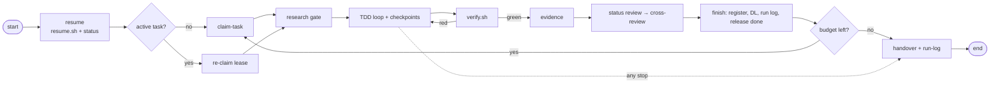

---

## 2. Task lifecycle / backlog loop

**Purpose.** Move each card through the status model in dependency order with exactly one lease
holder, and keep the backlog the single queue of work.

**Trigger.** No active task in `.agent/state.json`, a task reaches `done`/`blocked`, or new work
is discovered (split, follow-up, review finding).

**Steps.**
1. Pick the first `todo` card in `.agent/backlog/README.md` whose `depends_on` are all `done`
   (`claim-task`).
2. `node scripts/agent/conductor.ts claim T-NNNN --provider <claude|codex>` → `claimed`; branch
   `feat/T-NNNN-<slug>`.
3. Open questions/RQs → `researching` (loop 3); else `in_progress`.
4. All criteria green → `verifying` (`bash scripts/agent/verify.sh`) → `review` (loop 7).
5. Review PASS + gates green → `node scripts/agent/conductor.ts release T-NNNN --status done`.
6. New work found at any step → `new-task-card` (never widen the current card beyond one
   session; split instead). Replaced cards are superseded, never deleted.

**Exit condition.** Card `done` with review PASS, evidence linked and lease released.

**Failure path.** Gate fails → back to `in_progress`. Human needed or 3 failed attempts across
providers (`max_attempts_per_task: 3`) → `blocked` with reason
(`node scripts/agent/conductor.ts release T-NNNN --status blocked --reason "<text>"`), loop 11.
Provider stops mid-task → `release --status todo` or lease expiry → loop 6.

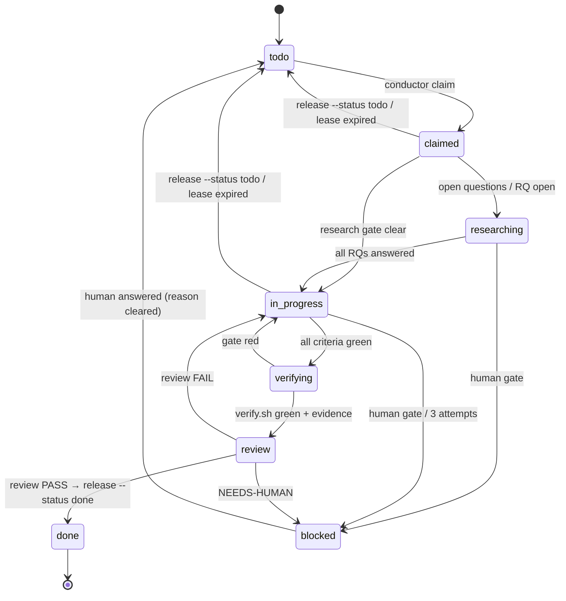

---

## 3. Research loop

**Purpose.** No code is written on an unverified assumption: unclear requirements, APIs,
regulations or library behaviour are resolved with real sources first (`AGENTS.md` §0.4).

**Trigger.** A card has *Open questions* or a linked RQ with `status: open`; or during build or
review an assumption turns out to be uncertain.

**Steps.** (`research` skill, role `researcher`)
1. Search existing RQs; reuse if answered.
2. Create `Docs/research/RQ-NNNN-<slug>.md` from `Docs/research/RQ-0000-template.md`, link it in
   the card, card → `researching`.
3. Collect primary sources (vendor docs, regulator, standard, library source) with URL and date.
4. Ambiguity → spike (minimal reproducible experiment, command + output recorded).
5. Conclude with answer, confidence, consequences; follow-up decisions → loop 9.
6. `status: answered` → card `in_progress`, checkpoint.

**Exit condition.** No linked RQ is `open`.

**Failure path.** Sources conflict or are missing → spike; still unresolved → choose the most
conservative option inside scope and log it (loop 9). If the question is a human-gate subject
(accounting/security treatment, scope, design §11.2) → `status: answered-pending-human`,
dependent criteria blocked, loop 11. Never block on a purely technical unknown — build what is
missing (`AGENTS.md` §0.5).

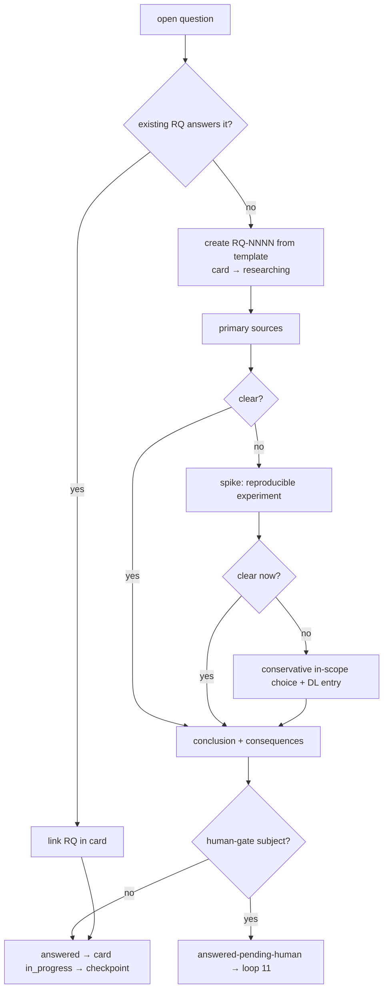

---

## 4. TDD red-green-refactor loop

**Purpose.** The expected result exists as a failing test before any production code
(`AGENTS.md` §0.2). Detail: [`tdd.md`](tdd.md).

**Trigger.** Each acceptance criterion / step of an `in_progress` card.

**Steps.** (`tdd-cycle` skill)
1. Preconditions: no open RQ; accounting → golden posting **Approved**; UI → SS exists.
2. Write the acceptance test from the card/spec/golden posting (never from code output).
3. Run it; capture RED output into the run log and card.
4. Confirm it fails for the right reason (assertion on missing behaviour).
5. Implement the minimum.
6. GREEN: same command passes; `bash scripts/agent/verify.sh --quick`.
7. Refactor with tests green.
8. Checkpoint (loop 5); next criterion.

**Exit condition.** All criteria green → `verify` skill.

**Failure path.** Wrong-reason RED → fix the test/harness, re-run. Cannot reach honest green →
`blocked` with the RED output (never skip/weaken). Golden posting missing/Draft →
`golden-posting` proposal, loop 11 for that criterion.

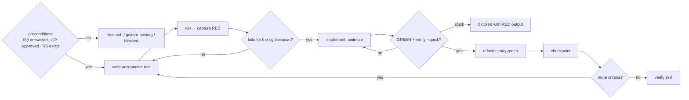

---

## 5. Checkpoint / heartbeat loop

**Purpose.** A dead session loses minutes, not hours; the lease proves the holder is alive.

**Trigger.** Every green step, and at least every `heartbeat_minutes: 10` while holding a lease
(`lease_minutes: 45`).

**Steps.** (`checkpoint` skill)
1. `bash scripts/agent/verify.sh --quick` green.
2. Update card steps and *Notes for the next agent*.
3. `node scripts/agent/conductor.ts checkpoint T-NNNN --step "k/n — <text>"` — commits
   `wip(T-NNNN): step k/n — <text>`, renews the lease, sets `last_checkpoint`, updates
   `.agent/state.json` and the HANDOVER skeleton.
4. Refresh HANDOVER narrative fields; append to the run log.

**Exit condition.** Commit recorded; lease renewed to now + 45 min.

**Failure path.** Not green when heartbeat is due → get to green quickly or `handover` (never
checkpoint red). Conductor reports the lease is lost → stop immediately, write the run log, end.
No heartbeat before lease expiry → the conductor treats the session as dead (loop 6).

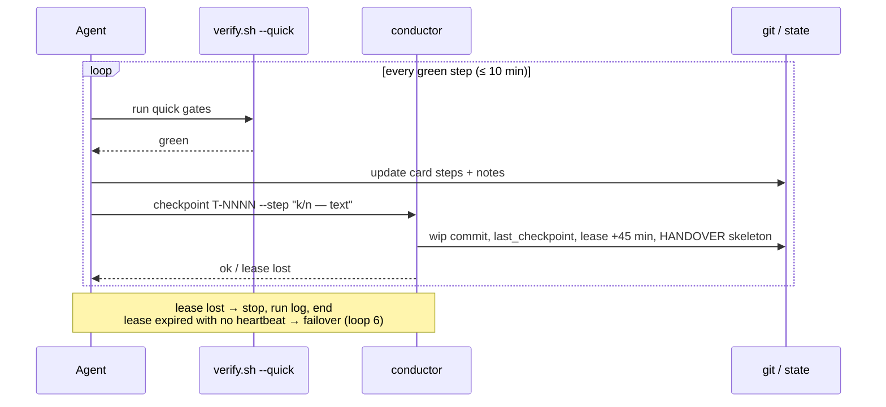

---

## 6. Provider failover loop (Claude ↔ Codex)

**Purpose.** Keep building when one provider runs out of credit, hits a quota/rate limit or dies,
with no lost work (design §10.4). Configured in `.agent/config.yaml`: `failover_order:
[claude, codex]`, `failure_patterns.quota`, `lease_minutes`, `max_attempts_per_task`.

**Trigger.** Started by `node scripts/agent/conductor.ts run`; failure detected by any of:
1. non-zero exit code **and** stdout/stderr matching a `failure_patterns.quota` pattern (`429`,
   `rate.?limit`, `insufficient_quota`, `credit balance`, `usage limit`, `quota exceeded`,
   `overloaded`);
2. no heartbeat (checkpoint) before `lease_expires_at`;
3. the agent wrote `status: blocked`, or exited non-zero for another reason.

**Steps.**
1. Conductor launches the current provider headless (`claude -p` or `codex exec`) with the
   resume context pack.
2. On failure: if the working tree has uncommitted changes, commit them to a `wip/` commit
   (nothing is lost; it is **not** the green checkpoint).
3. Write the reason into `.agent/HANDOVER.md`; release the lease; increment `attempts` for the
   task.
4. Quota-type failure → switch to the next provider in `failover_order`; other failure → same
   or next provider per conductor policy.
5. Next provider runs loop 1: resumes the **same branch** from `last_checkpoint` (the `wip/`
   commit is available to inspect and salvage — it must pass the TDD loop before it counts).
6. `attempts` reaches 3 across providers → card `blocked`, human notified with the run logs.

**Exit condition.** Task progresses under the next provider, or is `blocked` after 3 attempts.

**Failure path.** All providers in quota failure → conductor waits/stops and leaves a HANDOVER
reason `all providers exhausted`; `node scripts/agent/conductor.ts status` shows it.

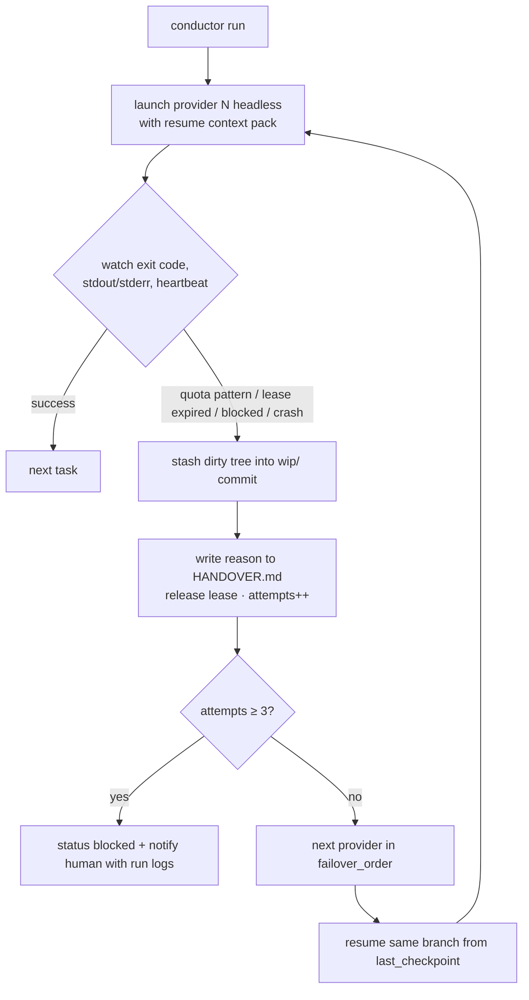

---

## 7. Cross-provider review loop

**Purpose.** An independent provider checks every task against the definition of done, the
design §11.3 checklist and the guardrails (`review: cross_provider`).

**Trigger.** Card status `review` (after `verify` green + evidence).

**Steps.** (`cross-review` skill, role `reviewer`; `security-reviewer` too when security-relevant)
1. Reviewer provider ≠ card `claimed_by`.
2. Re-run gates and the shortcut/deletion/ledger-bypass/float searches.
3. Answer A1–A8, B1–B12, C1–C12 with pass/fail/unclear + evidence.
4. Report → `.agent/evidence/<T-ID>/review-<provider>-<YYYYMMDD-HHMMSS>.md`, commit, post to PR.
5. PASS → builder side finishes and releases `done`. FAIL → findings become card steps,
   `in_progress`, back to loop 4. NEEDS-HUMAN → loop 11.

**Exit condition.** A PASS report exists for the head commit.

**Failure path.** Same provider would review → `INELIGIBLE`, conductor reassigns. Two FAIL
rounds that disagree on the same item → the item becomes a DL entry with the reasoning
(loop 9); if it is a human-gate subject, loop 11.

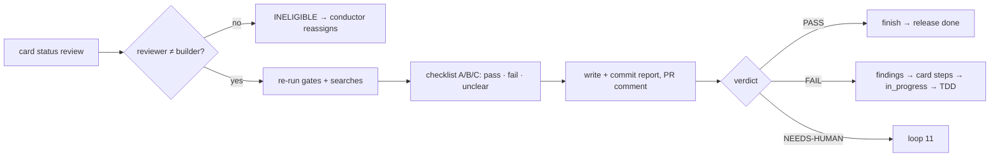

---

## 8. Evidence loop (Playwright)

**Purpose.** Prove behaviour visually and reproducibly (`AGENTS.md` §0.8).

**Trigger.** A card with `success_scenarios:` or any UI/report/export change, after `verify` is
green on a checkpointed commit.

**Steps.** (`evidence` skill, role `qa-evidence`)
1. Playwright spec `tests/e2e/<area>/<screen>.spec.ts`, one test per SS id, asserts the outcome,
   then calls the `evidence(scenarioId, slug)` fixture from `@ledgerforce/testing/evidence`,
   which saves `.agent/evidence/<T-ID>/<YYYYMMDD-HHMMSS>-<scenario-id>-<slug>.png`.
2. `LF_TASK_ID=T-NNNN pnpm test:e2e`.
3. The fixture appends to `.agent/evidence/<T-ID>/manifest.json` (`entries[]`):
   `{scenario, file, test, commit, provider, timestamp, result}` with the real outcome.
4. Validate files exist; link in card `evidence:` and in `Docs/specs/success-scenarios.md`.
5. Checkpoint.

**Exit condition.** Every SS id of the card has a `result: "passed"` entry whose `commit` is an
ancestor of the branch head.

**Failure path.** Scenario fails → record honest `fail` entry, card → `in_progress`, loop 4.
Never overwrite or delete earlier evidence; re-runs append.

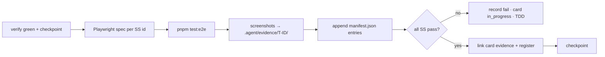

---

## 9. Decision loop

**Purpose.** Every decision is traceable (`AGENTS.md` §0.7); big ones get an ADR; accounting and
security ones wait for the human (design §10.6).

**Trigger.** Any choice: library/tool, interpretation of the spec, convention, research
conclusion, scope change, ADR status change.

**Steps.**
1. Does design §10.6 apply (data model, accounting treatment, security model, public API,
   integration contract, runtime dependency)? → `write-adr` (status `Proposed`).
2. Always → `log-decision` (DL entry, `ADR:` link).
3. ADR category `accounting`/`security` or design §11.2 subject → human gate (loop 11); DL
   status `proposed (awaiting human)`.
4. Other ADRs → `Accepted` when CI is green and cross-review agrees (loop 7).
5. Mention DL/ADR ids in HANDOVER *Decisions taken* and the run log.

**Exit condition.** DL entry merged; ADR `Accepted` (or `Proposed` + gate recorded).

**Failure path.** Decision later proves wrong → new DL entry `Supersedes DL-NNNN` / new ADR
superseding the old; old items only get a forward link — never edited or deleted.

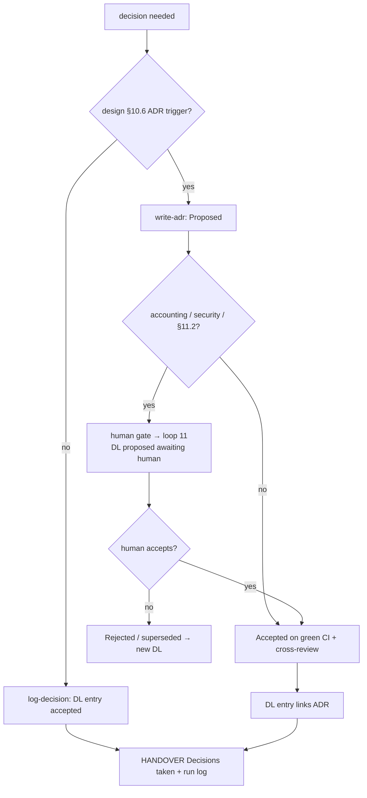

---

## 10. Success-scenario sync loop

**Purpose.** Keep the success-scenario register `Docs/specs/success-scenarios.md`, the tests
that implement each scenario, and the evidence that proves it, in agreement.

**Trigger.** End of every task (before `done`) and in the health loop (loop 12).

**Steps.** (role `qa-evidence` or `scribe`)
1. For each SS id in the register: find tests whose title contains it
   (`git grep -n "<SS-ID>" -- apps packages salesforce`).
2. For each card `success_scenarios:` entry: confirm the id exists in the register.
3. For each manifest entry: confirm the file exists and `result` is recorded.
4. Update register rows (test, latest evidence, status) using the format at the top of the
   register; update card `evidence:` lists.
5. Gaps → test missing: new step on the owning card (or `new-task-card`); evidence missing:
   evidence loop; register missing an id used in tests: add it as draft and flag in HANDOVER.

**Exit condition.** Every register SS id ↔ ≥1 test ↔ ≥1 passing evidence entry (for scenarios of
`done` tasks).

**Failure path.** A `done` task's scenario has no passing evidence → reopen via a new card
(never silently edit history); record in the run log.

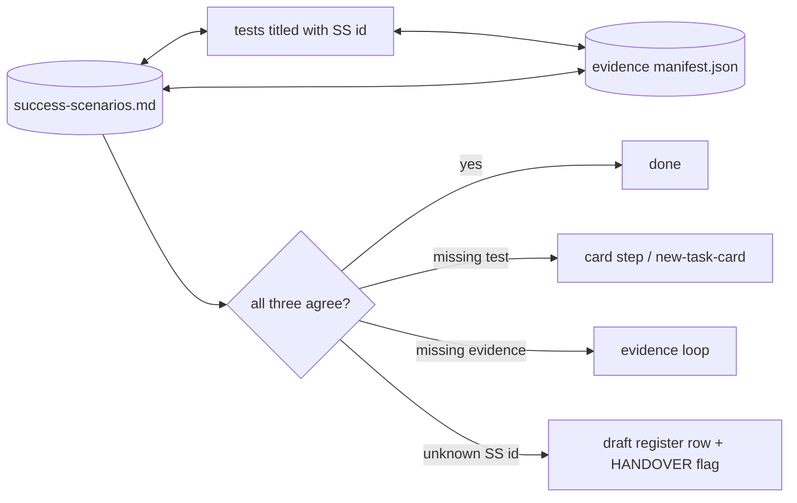

---

## 11. Human-gate escalation loop

**Purpose.** Consult the product owner only for the gates in `AGENTS.md` §6 /
`.agent/config.yaml → human_gates`, in a way that survives headless runs. Detail:
[`human-gates.md`](human-gates.md).

**Trigger.** A gate is hit: `adr:accounting`, `adr:security`, `golden_postings`, `release`,
`phase_gate`, `out_of_scope` (incl. undecided design §11.2 items).

**Steps.**
1. Prepare the decision for the human: RQ with sources, options, recommendation (ADR
   `Proposed` / golden posting `Draft` / scope note).
2. Record it in `.agent/HANDOVER.md` → *Open questions for human* (gate name, question, options,
   recommendation, file links).
3. PR label = gate name (`gh pr edit <number> --add-label <gate>`).
4. Affected criteria/card → `blocked`
   (`node scripts/agent/conductor.ts release T-NNNN --status blocked --reason "human gate: <gate> — <question>"`).
5. Continue with other eligible work (loop 2). Never wait interactively in headless mode.
6. When the human answers (ADR Accepted, GP Approved, label removed, answer in HANDOVER/PR):
   the next session logs it (DL entry, `By: human`), clears the block, card → `todo`.

**Exit condition.** Human decision recorded in the repo and the card unblocked.

**Failure path.** No answer → the card stays `blocked`; the health loop re-lists open human
questions in HANDOVER each night so they are never lost.

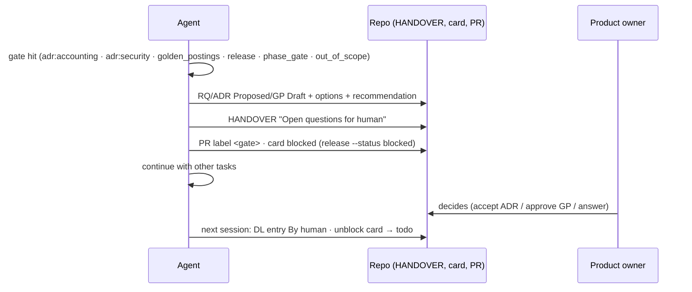

---

## 12. Nightly / periodic health loop

**Purpose.** Catch drift that no single task notices: backlog inconsistencies, stale leases,
broken links, orphaned evidence, forgotten human questions.

**Trigger.** Nightly (conductor schedule) or every 10 completed tasks, or when
`node scripts/agent/conductor.ts status` shows anomalies. Run as role `scribe`, branch
`chore/health-<YYYY-MM-DD>`.

**Steps.**
1. `node scripts/agent/conductor.ts status` — leases past `lease_expires_at` with no running
   session → release them (`release T-NNNN --status todo --reason "stale lease"`).
2. Backlog consistency: index ↔ cards (ids, titles, statuses, depends_on), no cycles, no `done`
   card with unchecked steps, every `blocked` card has a reason, `attempts` ≤ 3.
3. Link check over `AGENTS.md`, `Docs/**/*.md`, `.agent/**/*.md`, `.claude/**/*.md`:
   ```bash
   node -e "const fs=require('fs'),p=require('path');const files=require('child_process').execSync(\"git ls-files '*.md'\").toString().trim().split('\n');let bad=0;for(const f of files){const t=fs.readFileSync(f,'utf8');for(const m of t.matchAll(/\]\(([^)#\s]+)(#[^)]*)?\)/g)){const u=m[1];if(/^[a-z]+:/i.test(u)||/NNNN|</.test(u))continue;if(!fs.existsSync(p.resolve(p.dirname(f),u))){console.log(f+': '+u);bad++}}}process.exit(bad?1:0)"
   ```
4. Success-scenario sync (loop 10); decision log ↔ ADR links (scribe check 3).
5. Re-list unanswered human questions at the top of HANDOVER *Open questions for human*.
6. `bash scripts/agent/verify.sh` on `main` head — a red `main` becomes a top-priority card.
7. Fixes are made as normal commits; anything larger than a doc fix becomes a card
   (`new-task-card`). Write a run log.

**Exit condition.** All checks pass or every remaining issue has a card.

**Failure path.** Health loop cannot run (tooling broken) → card `T-NNNN chore: repair health
loop` at the top of the backlog.

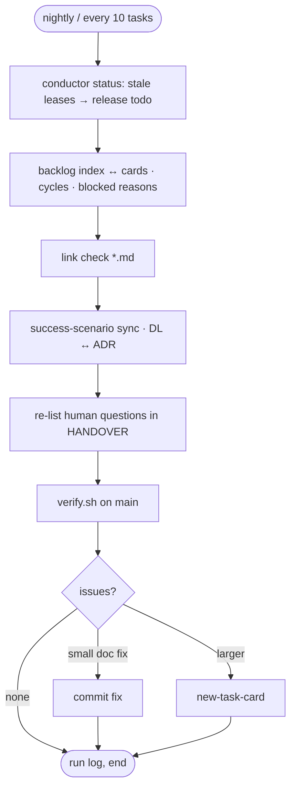
