# LedgerForce UI — what it will look like

Sprint 0 design pack. Open [`mockups/index.html`](mockups/index.html) in a browser for the
clickable gallery, or scroll the screenshots below.

| File | What it is |
|---|---|
| [`principles.md`](principles.md) | The 12 UI principles, each with why, do/don't and how it is tested |
| [`design-tokens.md`](design-tokens.md) · [`tokens.css`](tokens.css) | Colour (light + dark), status palette, type, spacing, radii, elevation, density; WCAG contrast table |
| [`information-architecture.md`](information-architecture.md) | Navigation map, role-based visibility (§6.4), screen inventory mapped to UC-01..12 |
| [`mockups/`](mockups/) | 12 static HTML mockups + gallery; shared `shell.css` / `shell.js` (no network, no build step) |
| [`screenshots/`](screenshots/) | Generated PNGs + `check-report.json` |
| [`tools/contrast.mjs`](tools/contrast.mjs) | Token contrast check (WCAG 2.2 AA), exits 1 on failure |
| [`tools/screenshot-mockups.mjs`](tools/screenshot-mockups.mjs) | Screenshots every mockup and runs page checks |
| [RQ-0080](../research/RQ-0080-ui-patterns-accessibility.md) | Research behind the choices (WCAG, tabular money, preview posting, density, SLDS) |

## Regenerate and check

```bash
node Docs/ui/tools/contrast.mjs                 # 90 token pairs, light + dark
node Docs/ui/tools/screenshot-mockups.mjs       # 28 screenshots + checks
AXE_PATH=/path/to/axe-core/axe.min.js node Docs/ui/tools/screenshot-mockups.mjs   # also run axe-core
```

The screenshot script uses the globally installed Playwright, serves `Docs/ui` on a loopback port,
and fails on: console errors, any external request, missing/duplicate `<h1>`, missing `<title>` /
`<main>` / `lang`, horizontal page scroll (every screen is also checked at 390×844), any visible
text node under 4.5:1 against its rendered background, and (when axe-core is available) any WCAG
2.x A/AA violation. Last run: 28 screenshots, 0 problems, axe 0 violations.

## Screens

The demo company is **Harbour & Co Pty Ltd**, a 14-person Sydney Salesforce consultancy. People:
Sam Nguyen (Owner), Priya Shah (Accountant / Finance Admin), Jordan Lee (AR Clerk), Lena Ortiz
(AP Clerk), Mei Tan (outside accountant, Approver). All figures add up (GST 10%).

### 01 · Home — [open](mockups/01-home-dashboard.html)
Cash in bank, who owes you, what you owe, GST due, "needs your approval" with the SoD reason, AR
ageing, close progress, Salesforce sync health and the small-team-mode exceptions card.

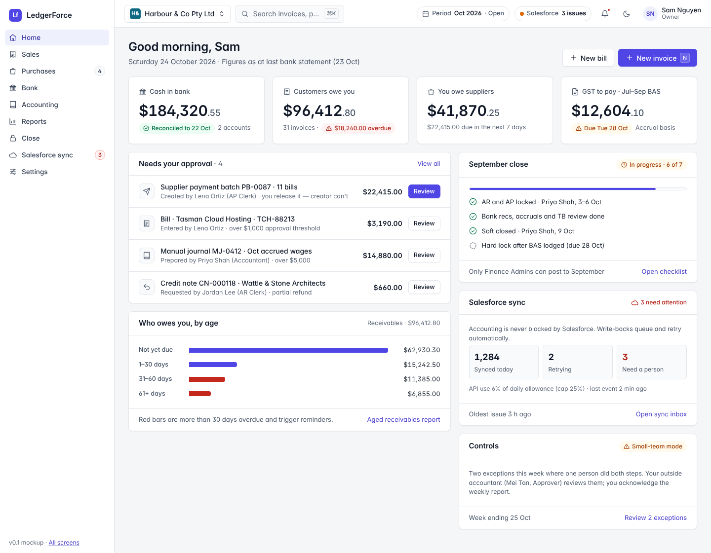

Dark theme:

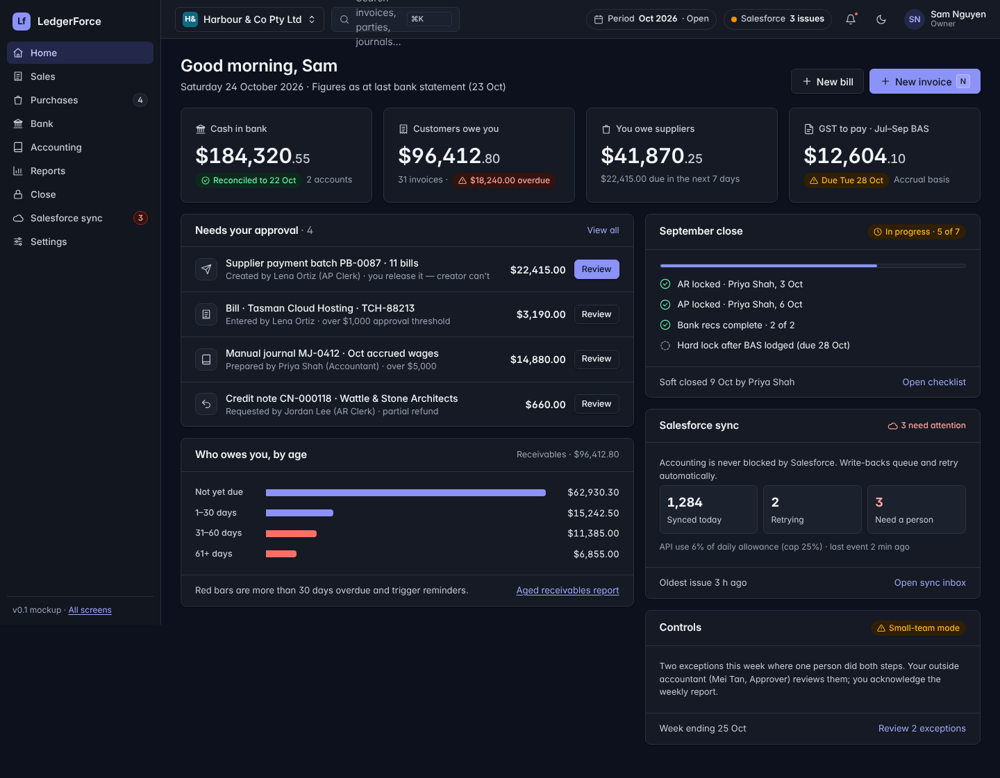

### 02 · Invoices — [open](mockups/02-invoice-list.html) · UC-01, UC-04
Totals strip, status segments with counts, filters, Comfortable/Compact density, bulk reminders,
a Salesforce sync column with link on every row, voided invoices kept and struck through.

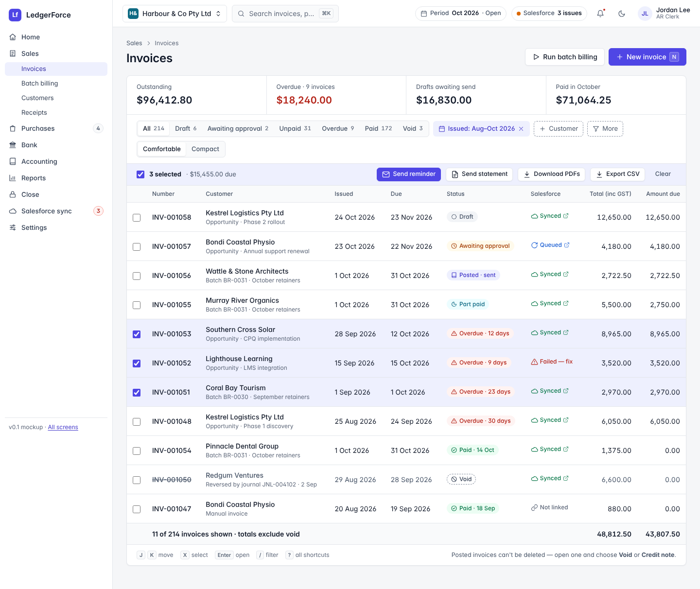

### 03 · Invoice detail — [open](mockups/03-invoice-detail.html) · UC-01, UC-11
Lines with product profile tags and GST, the posted journal panel (balanced, with the posting
profile that chose the accounts), Salesforce fields written, audit trail, and the "Need to correct
this invoice?" card: credit note, **Void — creates a reversal journal**, no delete.

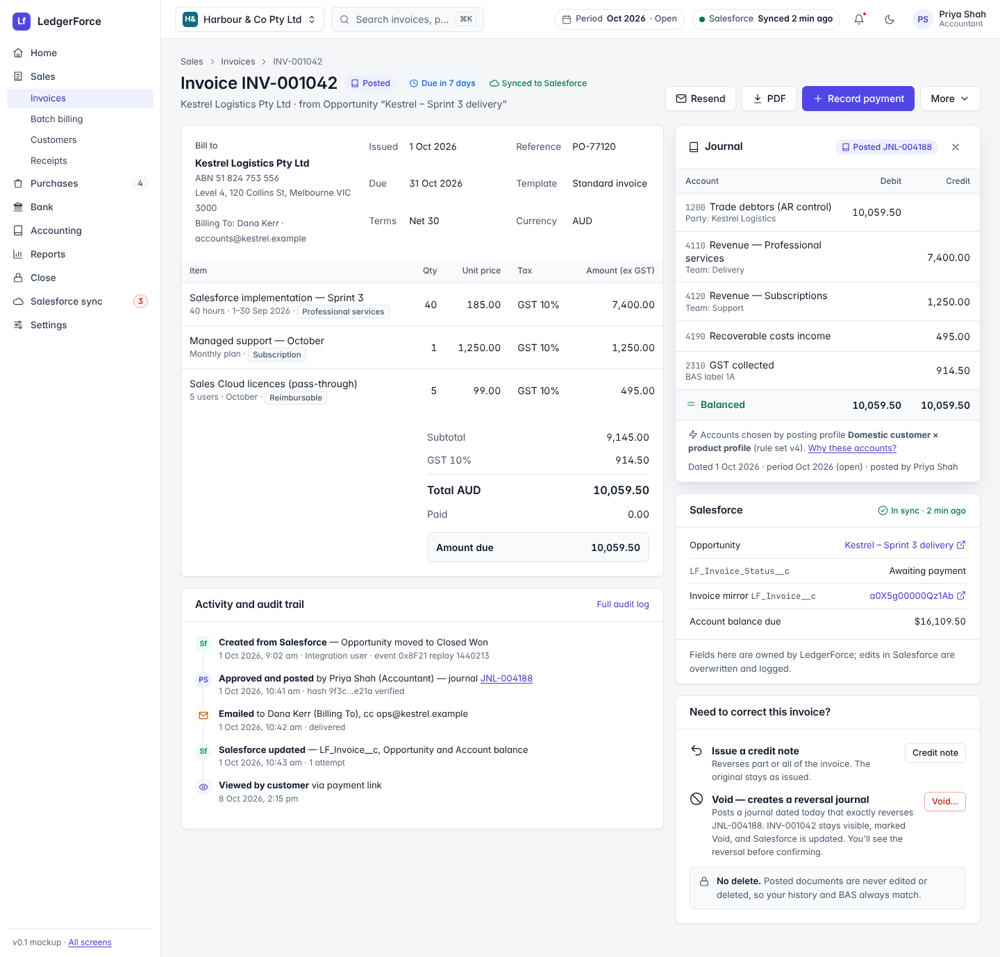

### 04 · Batch billing preview — [open](mockups/04-batch-billing-run.html) · UC-02
Step 2 of 4: 38 of 40 ready, 2 excluded (no Billing To contact; credit hold) and 3 warnings with
"what happens", the summed batch journal, prepared-by → approver, and "Approve and post 38".

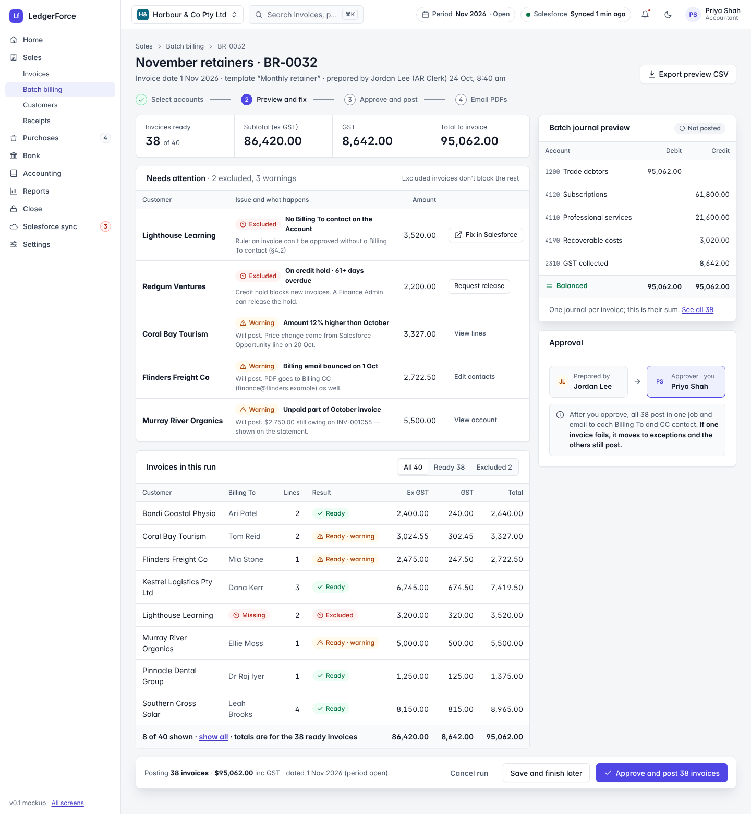

### 05 · Release supplier payments — [open](mockups/05-payment-batch-release.html) · UC-06
Maker-checker chain (created by Lena → 1st release Mei → 2nd release you), step-up MFA code entry,
one supplier held back by the 24-hour bank-change cooling-off, masked bank accounts, ABA file panel.

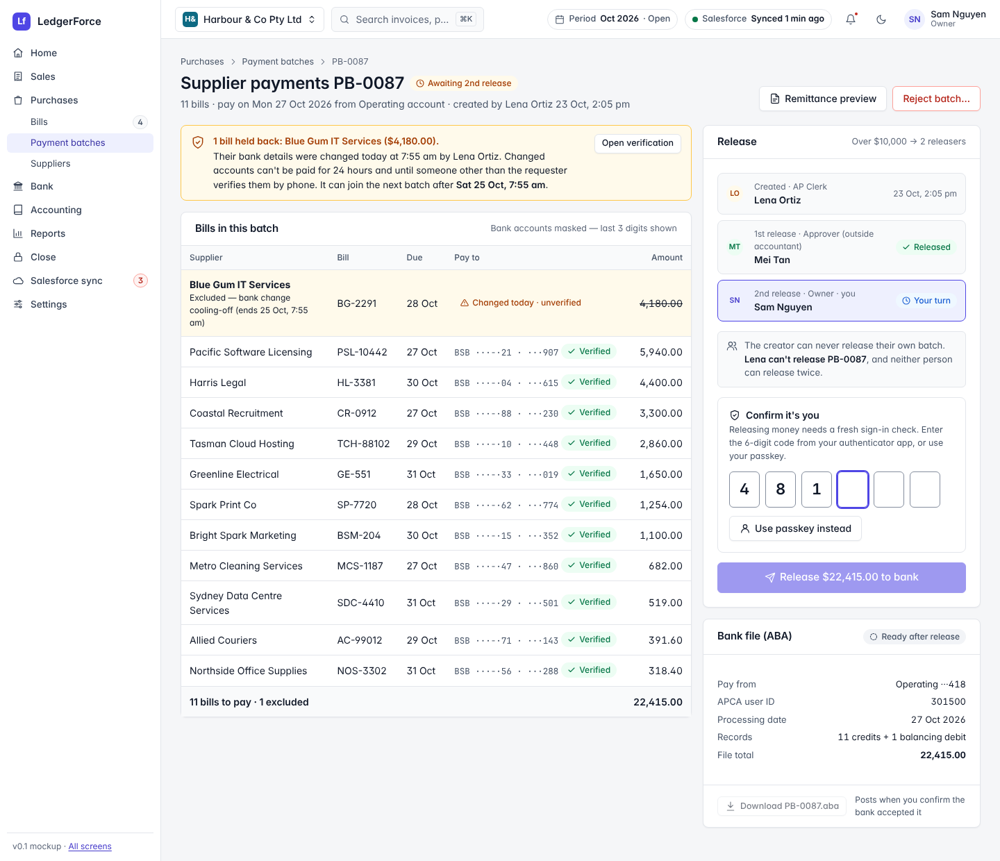

### 06 · Bank reconciliation — [open](mockups/06-bank-reconciliation.html) · UC-08
Statement balance vs book balance with the difference explained, 38/44 auto-matched, and the
remaining lines with exact, rule, transfer and "no exact match" suggestions.

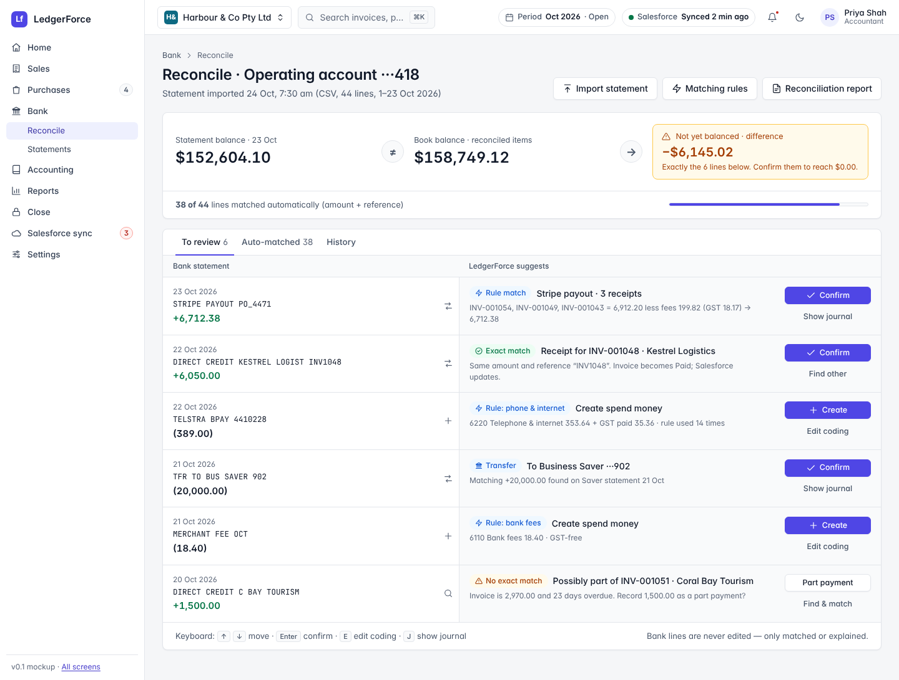

### 07 · Month-end close — [open](mockups/07-period-close-checklist.html) · UC-10
Staged close AR lock → AP lock → bank recs → accruals → TB review → soft close → hard lock after
BAS, each with who and when; what's locked right now; postings that were blocked or redirected.

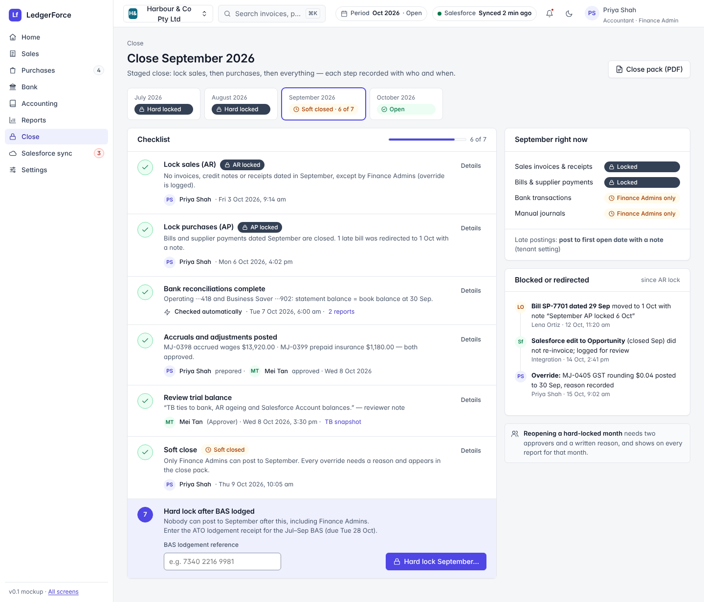

### 08 · Setup wizard, step 7 — [open](mockups/08-setup-wizard.html) · §4.1, §4.4
Progress through 10 steps; the customer type × product type matrix with defaults, overrides and
red gap flags (with how many Opportunities hit each gap); choosing an account shows its journal.

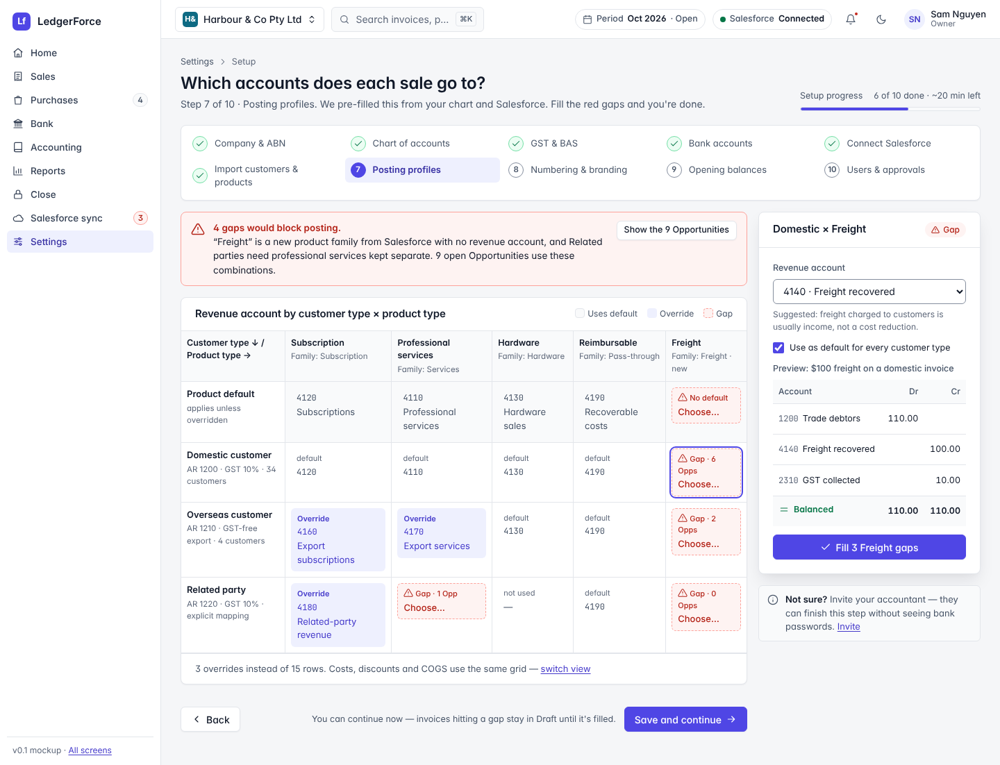

### 09 · Sync issues inbox — [open](mockups/09-sync-issues-inbox.html) · §5.6
"Your books are not affected", items needing a person vs retrying automatically, the Salesforce
error translated into a suggested fix, attempts timeline, idempotency key, payload, Retry now.

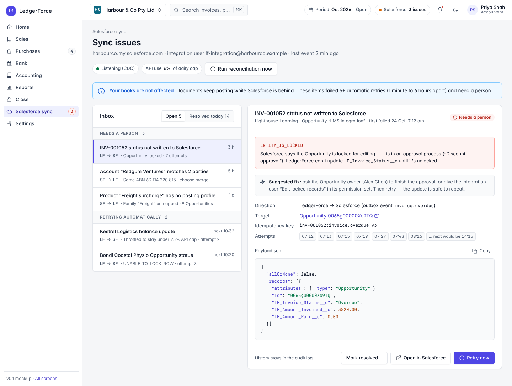

### 10 · Inside Salesforce — [open](mockups/10-salesforce-account-lwc.html) · UC-12
A simulated Lightning Account page with the LedgerForce "Finance" card: balance due, overdue,
last payment, five recent invoices — SLDS look, no LedgerForce login.

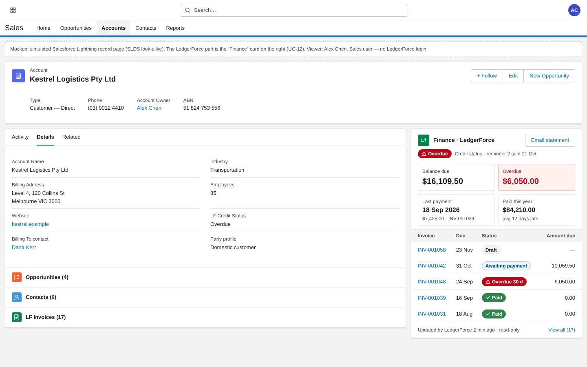

### 11 · Rule studio — [open](mockups/11-journal-rule-studio.html) · UC-09 (Phase 1)
The deposit rule from design §4.5 as YAML (guided form tab alongside), three test cases with
balanced preview journals (one correctly skipped), author ≠ activator.

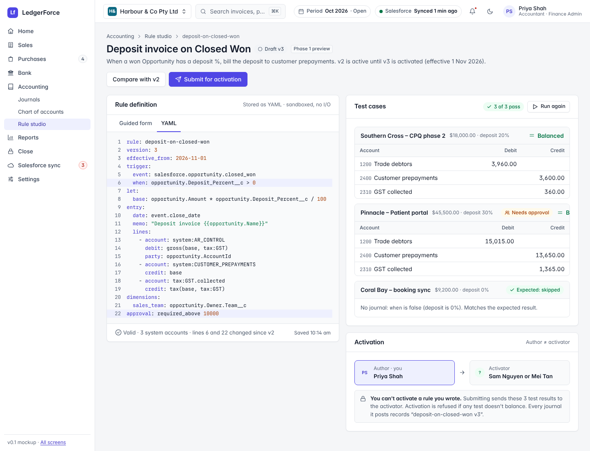

### 12 · Approve on your phone — [open](mockups/12-mobile-approvals.html) · UC-05 (390px)
Bill amount, why it needs you, coding, the journal that will post, attachment, history, and a
thumb-reach Reject / Approve bar.

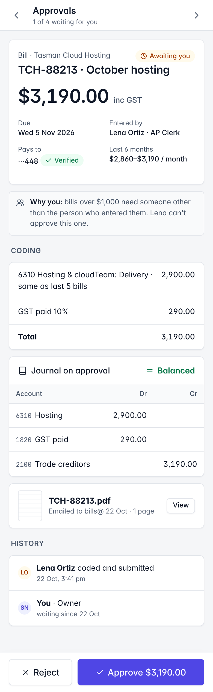

### Every screen on a phone (390px)
All desktop screens collapse to one column with the navigation behind a menu button and wide
tables scrolling inside their own region, e.g. invoice detail and bank reconciliation:

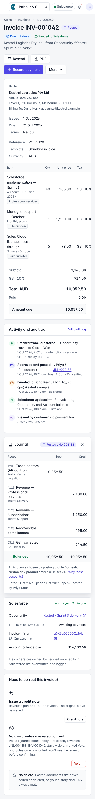 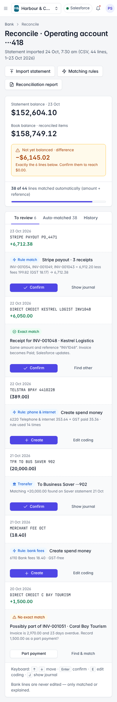

Other phone captures: `screenshots/*-390.png`. Gallery page: [`index-desktop.png`](screenshots/index-desktop.png), [`index.png`](screenshots/index.png) (390px).

## Notes for apps/web

- Mockup classes (`.chip`, `.num`, `.card`, `JournalPreview` panel …) are a visual reference; the
  real components are shadcn/ui + Tailwind reading the same tokens via the bridge in `tokens.css`.
- Icons in mockups are simplified Lucide-style glyphs; the app uses `lucide-react` (shadcn default).
- Inter is bundled locally in the app; mockups fall back to the system stack if Inter is absent.
- The Salesforce component (UC-12) uses SLDS base components only and none of these tokens.
