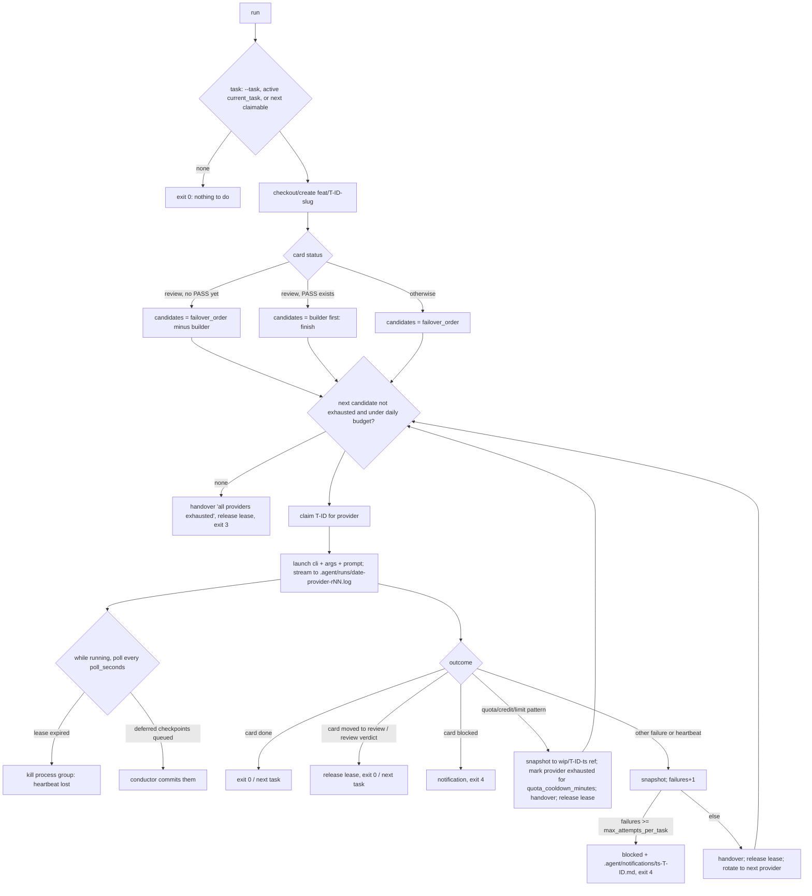

# scripts/agent — the LedgerForce conductor

These scripts run the build across two LLM providers: **Claude Code** first, **OpenAI Codex**
as failover and cross-reviewer (design §10.4–10.5, `AGENTS.md` §2–3). If Claude runs out of
credits or hits a usage limit, the conductor saves the work, writes the handover and starts
Codex on the same branch. Any session can be resumed from the repository alone.

Zero dependencies (DL-0005). Plain Node.js ≥ 22.18 runs the TypeScript directly, with no flags
and no `npm install`:

```bash
node scripts/agent/conductor.ts status
```

The code uses only erasable TypeScript: no enums, namespaces or parameter properties, and local
imports end in `.ts`.

| File | Purpose |
|---|---|
| `conductor.ts` | CLI: claim, checkpoint, release, set-status, handover, status, next, run (failover loop), lease-check, lint-backlog, gate |
| `resume.sh` | Prints the resume context pack, which every session reads first |
| `verify.sh` | Definition-of-done runner, gates 1–12 of `Docs/process/definition-of-done.md` |
| `checkpoint.sh`, `handover.sh` | Thin wrappers for humans |
| `lib/yaml.ts` | Minimal YAML reader for `config.yaml` and card frontmatter (subset documented in the file) |
| `lib/frontmatter.ts` | Card frontmatter parse and in-place update (keeps comments and body) |
| `lib/backlog.ts` | Card loading, dependency order, next claimable, backlog lint |
| `lib/commands.ts` | claim, checkpoint, release, set-status, handover, status, lease-check |
| `lib/run.ts` | The failover loop and provider failure classification |
| `lib/gates.ts`, `lib/review.ts` | Card- and diff-level checks for `verify.sh`, cross-review reports |
| `test/` | `node:test` suite with fixtures and fake provider CLIs (`test/fixtures/bin/*.sh`) |

Tests: `node --test scripts/agent/test/` (one process, through `test/index.js`) or
`node --test scripts/agent/test/*.test.ts` (one process per file). Every git-based test runs in
a fresh `mkdtemp` repository and never touches the real repo.

---

## Commands

All commands find the repo root with `git rev-parse --show-toplevel` (override: `LF_ROOT`).
`LF_NOW=<ISO time>` freezes the clock, which tests use.

| Command | What it does |
|---|---|
| `claim <T-ID> --provider <claude\|codex>` | Refuses if the status is not `todo` or an expired claim, if a `depends_on` task is not `done`, or if another unexpired lease exists (`parallel_tasks`). Otherwise it writes `status: claimed`, `claimed_by`, `lease_expires_at` (now + `lease_minutes`) and `attempts+1` to the card and `.agent/state.json`. **A card in `review`** keeps its status and `claimed_by` (the builder). The claimer is recorded as `reviewer`, and the builder is refused (no reviewing your own work) until a PASS cross-review exists. |
| `checkpoint [T-ID] --step "<text>"` | Renews the lease, appends the step to the HANDOVER `## Log`, then runs `git add -A` and `git commit -m "wip(T-ID): <text>"` (only if there are changes). It then sets `last_checkpoint` (card) and `last_green_commit` (state) to that sha. Those two metadata edits happen after the commit and travel with the next checkpoint. The task defaults to `state.current_task`. With `LF_DEFER_COMMIT=1`, or when `.git` is read-only, the step is queued in `state.pending_checkpoints` for the conductor to commit (see *Codex and .git* below). |
| `release <T-ID> --status <done\|blocked\|todo\|verifying\|review> [--reason …]` | Clears the lease (card and state) and sets the status. `blocked` requires `--reason`, which is stored as `blocked_reason`. `todo` clears `claimed_by`; the other statuses keep it, because the builder identity matters for cross-review. `release --status review` hands the card to cross-review. |
| `set-status <T-ID> <status> [--reason …]` | `researching`, `in_progress` and `verifying` keep and renew the lease (in-flight). `done`, `blocked`, `todo` and `review` behave like `release`. |
| `handover --reason "<text>"` | Rewrites `.agent/HANDOVER.md` in the §10.5 template. It fills From, Reason, Task, Branch, Last green commit, Done and In progress from state and the card's `- [x]`/`- [ ]` steps. It leaves `[agent: …]` placeholders for Next action, Decisions taken and Open questions for human. Narrative fields already filled for the same task are carried over, and the `## Log` section is append-only. Runs offline and fast. |
| `status` | Phase, branch, current task, lease (active or EXPIRED), step, last green commit, backlog counts by status, exhausted providers, next claimable task. |
| `next [--count N]` | Next claimable task id(s): topological order of `depends_on`, ties broken by id. A card is claimable if it is `todo`, or in flight (`claimed`, `researching`, `in_progress`, `verifying`, `review`) with an expired or missing lease, and all its dependencies are `done`. |
| `run [--once] [--task T-ID] [--dry-run]` | The failover loop (below). `--dry-run` prints the task, mode, provider commands, run-log names and prompt, and writes nothing. |
| `lease-check` | Lists in-flight cards whose lease has expired or is missing, plus a stale `state.json` lease. Used by the health loop. |
| `lint-backlog` | Checks that frontmatter parses, `id` equals the file name, ids are unique, `title` and a valid `status` are present, `blocked` has `blocked_reason`, every `depends_on` exists, there are no cycles, and every `success_scenarios` id appears in `Docs/specs/success-scenarios.md` (when that file exists). |
| `gate <shortcuts\|migrations\|golden\|review\|evidence\|memory> [T-ID]` | A single definition-of-done check, used by `verify.sh`. Exit codes: 0 PASS, 1 FAIL, 10 PENDING. |

### Exit codes

| Code | Meaning |
|---|---|
| 0 | OK, including `run` with nothing to do |
| 1 | Usage error, unexpected error, lint errors, or expired leases found (`lease-check`) |
| 2 | Refused: bad status, unmet dependencies, lease held by someone else, self-review, missing argument |
| 3 | All eligible providers are exhausted (quota, credit, usage limit, daily budget), or no provider other than the builder can review |
| 4 | Task blocked: `max_attempts_per_task` reached, or the agent marked it blocked. A notification is written. |
| 10 | `gate` only: PENDING |

---

## The failover loop (`run`)



Details:

- **Same branch, from the last checkpoint.** All providers work on `feat/<T-ID>-<slug>` (or the
  card's `branch:` field). An existing branch is checked out; otherwise one is created from HEAD.
- **Nothing is ever lost.** Before any failover, uncommitted work is snapshotted into
  `refs/heads/wip/<T-ID>-<YYYYMMDDTHHMMSSZ>` using a temporary index (`commit-tree` +
  `update-ref`). The real index, HEAD and working tree are untouched, and the work also stays in
  the working tree for the next provider. The prompt and HANDOVER both name the snapshot ref.
  Nothing is reset, stashed-and-dropped or deleted.
- **Failure detection.** stdout and stderr are combined, and the last 64 KB are matched
  case-insensitively against `failure_patterns.quota` in `.agent/config.yaml`. The final Claude
  `{"type":"result"}` object is parsed too:
  - `subtype: error_max_budget_usd` counts as quota.
  - A non-zero exit or `is_error: true` counts as quota if a pattern appears anywhere, otherwise
    as a failure (with the `subtype`, for example `error_max_turns`).
  - Exit 0 with the task not done counts as quota if a pattern appears in the last 4 KB (the
    agent stopped on a limit after its handover). Otherwise it is a failure.
  - Codex exits 1 on every error (RQ-0001), and Claude prints in-run errors on stdout (RQ-0002).
    That is why both streams are scanned. The real message
    `You've hit your session limit · resets 7:30am (UTC)` is covered by a test.
- **Heartbeat.** The agent renews its lease at every checkpoint (at least every
  `heartbeat_minutes`). If `state.json`'s lease expires while the provider runs, the conductor
  kills its process group and counts a failure.
- **Retry policy.** Quota failures do not count as attempts; they switch provider. Other failures
  increase `state.failures[T-ID]` and rotate to the next provider (`retry_policy: rotate`; `same`
  is also supported). At `max_attempts_per_task` the task is `blocked` and a notification lists
  the run logs and the tail of the last one.
- **Exhausted providers** are recorded in `state.providers.<id>.exhausted_until`
  (`quota_cooldown_minutes`, default 60) and skipped by later runs until then.
- **Daily budget.** A provider is skipped when today's costs reach `budgets.<id>.daily_usd`. Costs
  are summed from `.agent/runs/<today>-<provider>-*.log` (the `conductor: cost_usd=` footer
  written from Claude's `total_cost_usd`, or a raw `"total_cost_usd"`). `.md` run logs that name
  the provider and contain a `cost … $X` line also count.
- **Cross-review routing** (`review: cross_provider`). A card in `review` goes to a provider other
  than `claimed_by`, with a cross-review prompt (`.claude/skills/cross-review`). The builder handing
  the card to review, or the reviewer writing a verdict, ends the session successfully and
  releases the lease. When a PASS report by a non-builder exists, the card is routed in *finish*
  mode, builder first.
- **Prompt.** "You are resuming LedgerForce task <id> … Follow AGENTS.md. Run the resume
  skill/script first …", followed by the rules for claim, checkpoint, verify, handover and blocked,
  and the resume context pack (truncated at `prompt_max_chars`, default 60 000). The prompt is the
  last argv element by default, or goes on stdin with `prompt_via: stdin`.
- **Environment for the provider:** `LF_PROVIDER`, `LF_TASK`, `LF_RUN_ID`, `LF_ROOT`,
  `LF_CONDUCTOR` (path to `conductor.ts`), and `LF_DEFER_COMMIT=1` for conductor-committed
  providers.
- **Run log** `.agent/runs/<date>-<provider>-rNN.log` holds a header (command and prompt), the raw
  provider output, and a footer with exit code, outcome and cost. `NN` counts all of the day's
  runs.

### Codex and `.git` (conductor-made commits)

Codex's `workspace-write` sandbox keeps `.git` read-only (RQ-0001: `PROTECTED_METADATA_PATH_NAMES`),
so Codex cannot commit. A provider with `commits: conductor` handles this as follows. It is the
default when its args contain `workspace-write`, so Codex is covered by default.

1. The conductor starts it with `LF_DEFER_COMMIT=1`. The agent still runs
   `conductor.ts checkpoint T-ID --step …`, which renews the lease (the heartbeat), logs the step
   and queues it in `state.pending_checkpoints` without touching `.git`. A checkpoint whose
   `git commit` fails with a read-only or permission error is queued the same way.
2. On every poll while Codex runs, and once more when it exits, the conductor commits the queued
   steps as `wip(T-ID): <step>` and records `last_checkpoint`.
3. When the session ends `done` or hands off, any remaining non-bookkeeping changes are committed
   as `wip(T-ID): codex rNN session end (committed by conductor)`. On failure or quota, the `wip/`
   snapshot applies as usual.

### Provider commands and defaults

`.agent/config.yaml` → `providers[].cli` + `args` (with placeholders `{repo}`,
`{last_message_file}`, `{run_id}`) + the prompt. When `args` is absent, these defaults apply:

| Provider | Default command | Source |
|---|---|---|
| claude | `claude -p --output-format stream-json --verbose --permission-mode acceptEdits --max-turns 200 "<prompt>"` | RQ-0002. `-p` starts in Manual mode, so a permission mode is always passed. Bash permissions come from `.claude/settings.json`. |
| codex | `codex exec --cd {repo} -s workspace-write -c sandbox_workspace_write.network_access=true --json -o {last_message_file} "<prompt>"` | RQ-0001. `--full-auto` was removed, and `.git` is read-only (conductor commits). |

Other `providers[]` keys: `commits: agent|conductor`, `prompt_via: arg|stdin`. Other top-level
keys (all optional): `quota_cooldown_minutes` (60), `retry_policy` (`rotate`), `poll_seconds`
(30; tests use `LF_POLL_MS`), `prompt_max_chars` (60000), `paths.notifications`
(`.agent/notifications`).

**To verify against the installed CLIs:** codex is not installed in this sandbox. The codex
flags are taken from RQ-0001 (binary and source of the version current on 2026-10-24) and have
not been executed here. The claude flags were checked against `claude --help`.

### Claude-only, Codex-only, or both

Edit `failover_order` in `.agent/config.yaml` (human-owned):

```yaml
failover_order: [claude, codex]   # both: Claude builds, Codex takes over and cross-reviews
failover_order: [claude]          # Claude only: quota → exit 3; review cards → exit 3 (no self-review)
failover_order: [codex]           # Codex only (conductor commits for it)
failover_order: [codex, claude]   # Codex first
```

Run it:

```bash
node scripts/agent/conductor.ts run --once --dry-run   # see what would happen
node scripts/agent/conductor.ts run --once             # one task, with failover
node scripts/agent/conductor.ts run                    # keep going until the backlog is empty or blocked
node scripts/agent/conductor.ts run --task T-0042      # a specific task
```

---

## resume.sh

Prints, in order: HANDOVER, state.json, the active task card in full, the next 5 claimable cards,
open research (`Docs/research/*.md` with `status: open`), the last 10 decision-log titles, the
tail of the newest run log, `git log --oneline -10`, `git status --short` and the latest `wip/`
snapshot refs. Each missing piece prints `(missing)` or `(none)`, and the script always exits 0.

## verify.sh

`bash scripts/agent/verify.sh [--quick] [--task T-NNNN]`. The task defaults to
`state.current_task`, then to a `feat/T-NNNN-*` branch name. Every gate prints one
`GATE <n> <name>: …` line, followed by a summary table. A gate whose tooling does not exist yet
prints `NOT YET AVAILABLE (no …)` and counts as **PENDING**. PENDING is never a pass and never a
failure, and it is printed loudly. The exit code is 1 on any FAIL.

| Gate | Check | `--quick` |
|---|---|---|
| 1 | `pnpm typecheck`, `pnpm lint`, `pnpm format:check` | yes |
| 2a | `pnpm test` + `node --test scripts/agent/test/*.test.ts` | yes |
| 2b | `pnpm test:db` | skipped |
| 2c | coverage (`vitest --coverage` json-summary) ≥ baseline `.agent/coverage-baseline.json` on `main` | skipped |
| 3 | `*.prop.test.ts` exist and ran green in 2a | yes |
| 4 | `*.golden.test.ts` ran green in 2a. Full run only: `Docs/accounting/` diff vs main fails if it touches a file containing Approved entries or adds `Status: Approved`; draft-only changes pass with a note (PR label `golden_postings`) | unit part |
| 5 | cross-tenant RLS test files exist and 2b passed | skipped |
| 6 | new/changed `*.sql` vs main contain no `DROP`/`RENAME`/`TRUNCATE`/`DISABLE TRIGGER` (comments ignored), and 2b applied the migrations | skipped |
| 7 | built-in secrets scan (always), `pnpm audit --prod`, semgrep if installed | secrets only |
| 8 | `.agent/evidence/<T-ID>/review-<provider>-*.md` with verdict PASS by a provider ≠ `claimed_by` (none: PENDING; latest FAIL: FAIL) | skipped |
| 9 | `pnpm test:e2e` + every `success_scenarios` id has a latest manifest entry `result: passed` whose file exists | skipped |
| 10 | no `.skip(`/`.only(`/`xit(`/`xdescribe(`/`.todo`/`{skip: true}` in test files; no added `numRuns` < 100; no added `eslint-disable`/`@ts-ignore`/`@ts-expect-error`/coverage-ignore without a `DL-NNNN` on the line | yes |
| 11 | no tracked file deleted or renamed: vs merge-base with `origin/main` (or `main`), staged, and in the working tree | yes |
| 12 | backlog lint (always). Full run with a task: all `## Steps` ticked, status verifying/review/done, linked `research:` RQs not `open`, HANDOVER present | lint only |

The secrets scan and backlog lint also run in `--quick` because they are cheap. That is stricter
than the table in `definition-of-done.md`.
